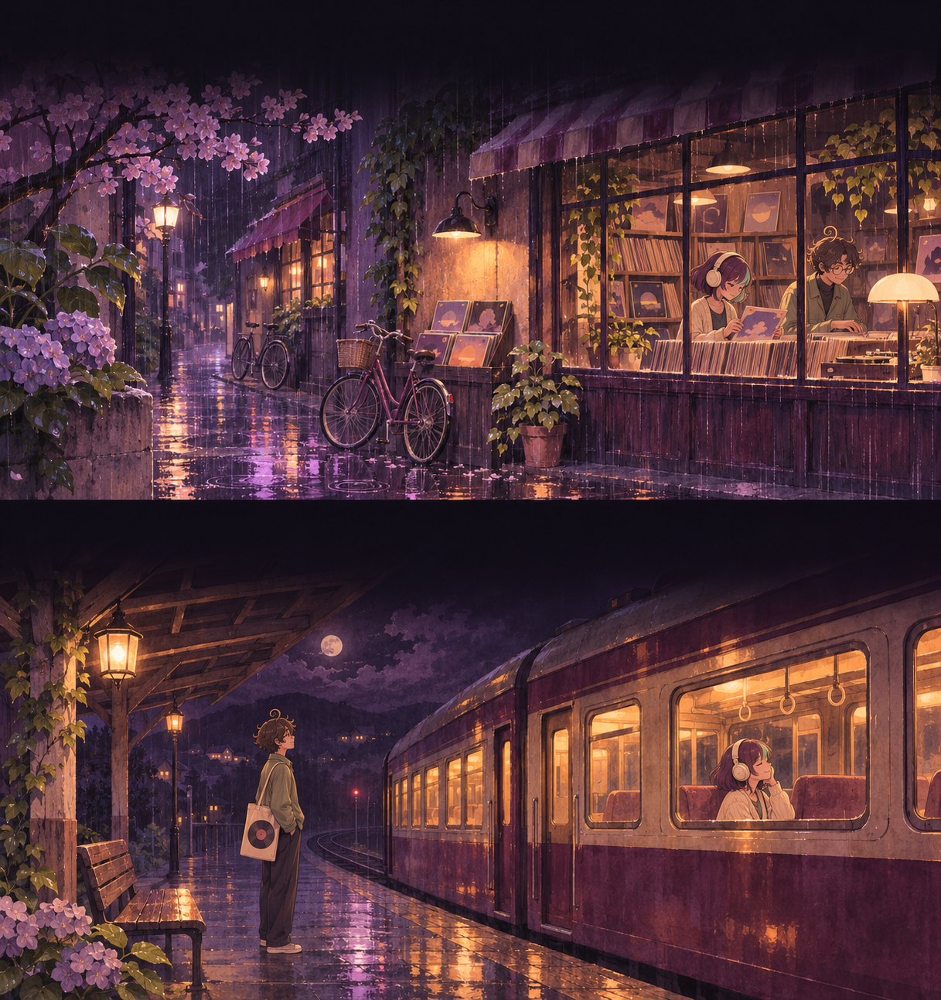
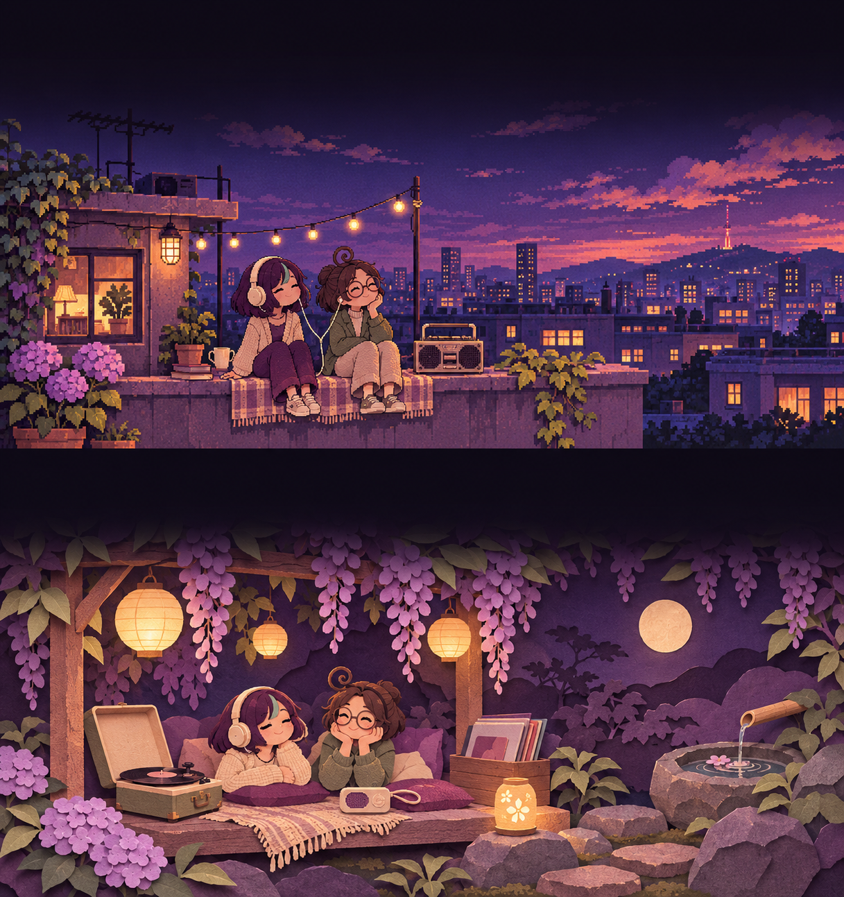
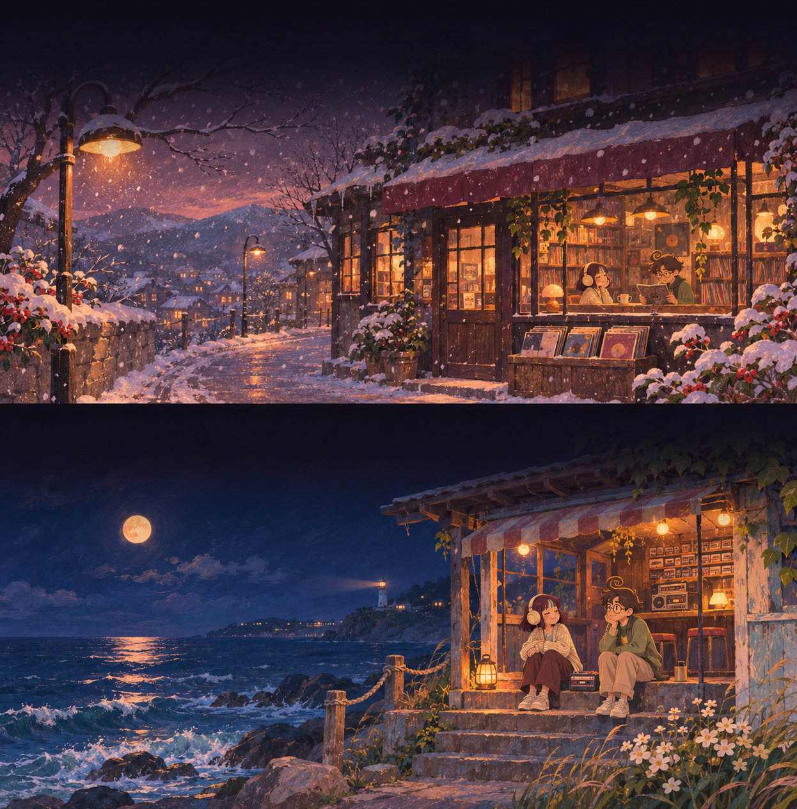
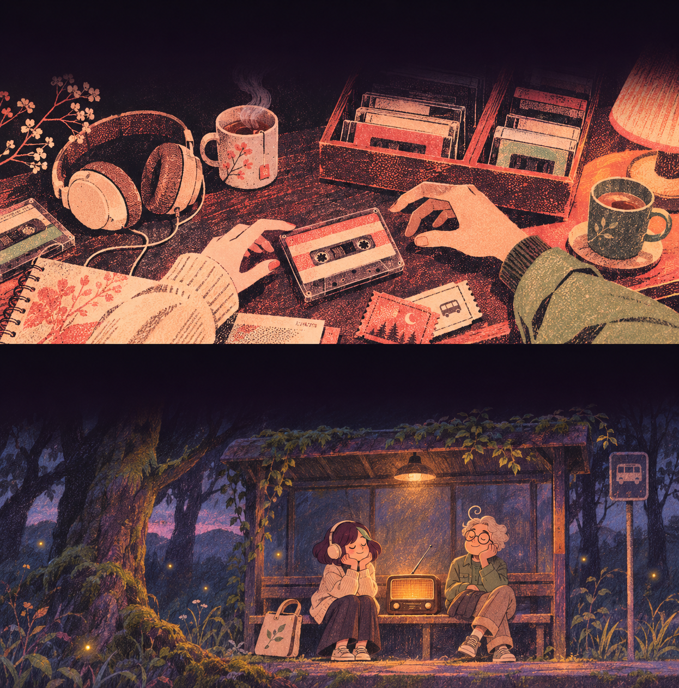
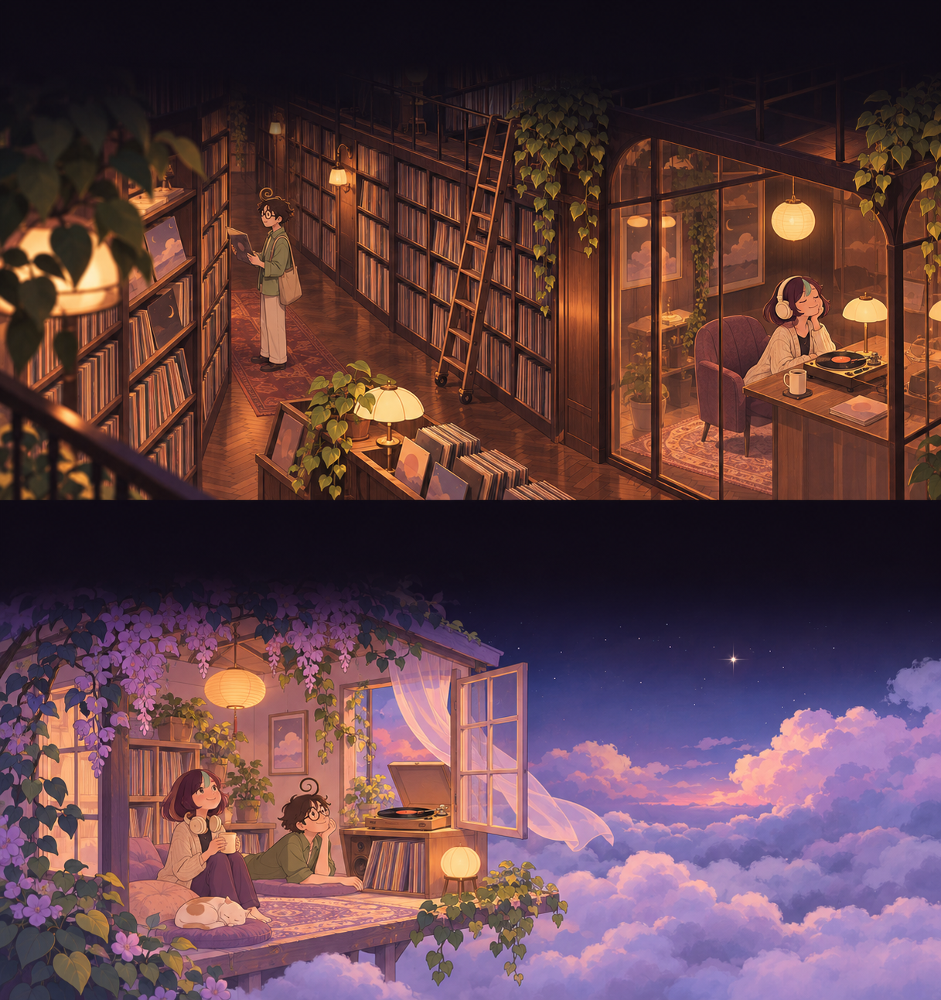

# Pippo Home artwork concepts

Ten ideas for the end of Pippo's Home feed. Each sheet has two concepts. The table lists the upper scene first and the lower scene second. These are still artwork previews for choosing a direction.

| Sheet | Upper scene | Lower scene |
| --- | --- | --- |
| [01–02](01-02.png) | **01 · Rainy Record Alley** — A warm record shop window and reflections on a rainy street. | **02 · Last Train Home** — A late-night listening moment at a sleepy station, in ink and watercolor. |
| [03–04](03-04.png) | **03 · Rooftop Radio** — Two friends share music against a dusk skyline in pixel art. | **04 · Moonlit Listening Garden** — Paper lanterns and vinyl tucked under layers of cut-paper wisteria. |
| [05–06](05-06.png) | **05 · Snowfall at the Listening Café** — A warm window on a winter lane, painted in gouache. | **06 · Seaside Cassette Club** — An amber kiosk against a deep blue coast, painted like an animated film backdrop. |
| [07–08](07-08.png) | **07 · After-Hours Mixtape Desk** — A risograph still life with cassettes, headphones, and late-night tea. | **08 · Firefly Listening Stop** — A forest shelter and an old radio in soft colored pencil. |
| [09–10](09-10.png) | **09 · The Midnight Record Library** — An isometric vinyl library with a glowing listening booth. | **10 · Cloudside Listening Room** — A quiet turntable room among lavender clouds in soft painted pastels. |

Pick a number to identify the scene. Each concept explores a dark upper edge that can blend into the Home feed.

## 01–02 · Rainy Record Alley / Last Train Home

## 03–04 · Rooftop Radio / Moonlit Listening Garden

## 05–06 · Snowfall at the Listening Café / Seaside Cassette Club

## 07–08 · After-Hours Mixtape Desk / Firefly Listening Stop

## 09–10 · The Midnight Record Library / Cloudside Listening Room

