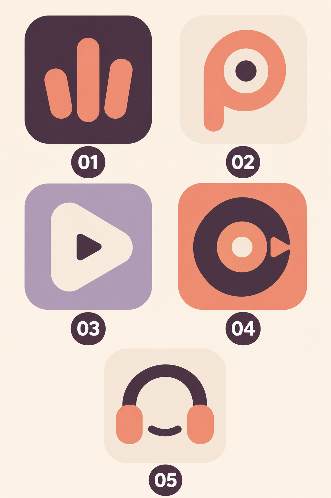
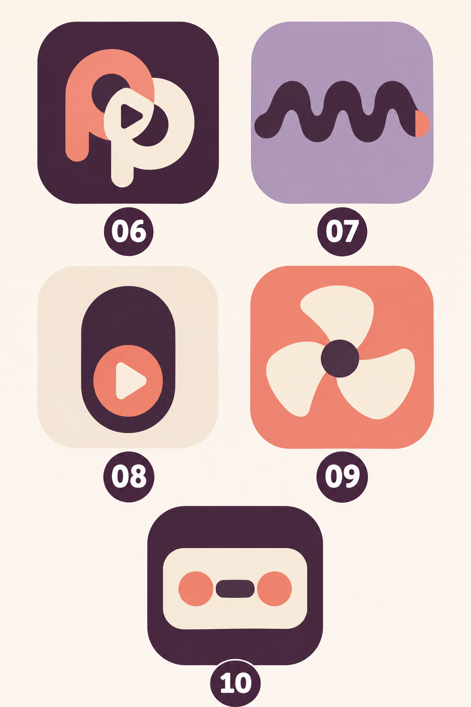

# Pippo main app icon concepts

Ten AI-generated visual directions, stamped 01–10 for selection. These are comparison previews, not production icon resources. Android launcher icons and app code have not been changed. No builds, tests or Actions were run.

| Stamp | Direction |
| --- | --- |
| 01 | Coral Pulse — three-bar sound wave |
| 02 | Soft Loop P — rounded P and record |
| 03 | Pillow Play — cushioned play symbol |
| 04 | Vinyl Bloom — record with a play notch |
| 05 | Friendly Headphones — headphones and smile |
| 06 | Twin P — intertwined loops and play |
| 07 | Wave Ribbon — continuous audio wave |
| 08 | Pocket Player — compact music-player mark |
| 09 | Sound Petal — abstract spinning music mark |
| 10 | Cozy Cassette — simple retro cassette |

## Stamps 01–05

## Stamps 06–10

Choose by stamp. The selected design can then be refined into precise vector geometry, adaptive foreground/background layers, monochrome art, color variants and raster exports.
