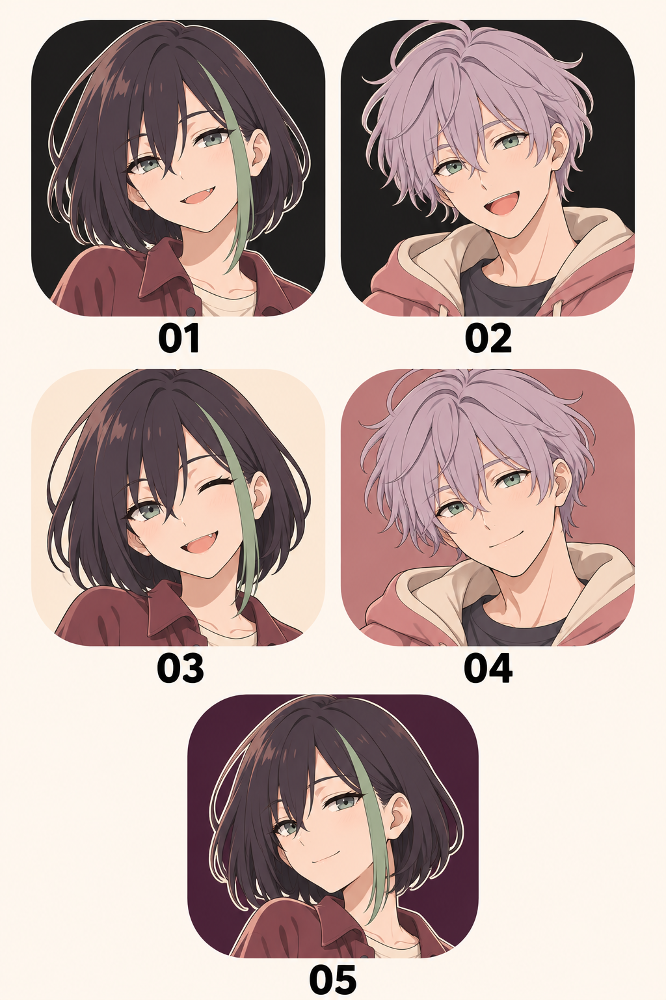
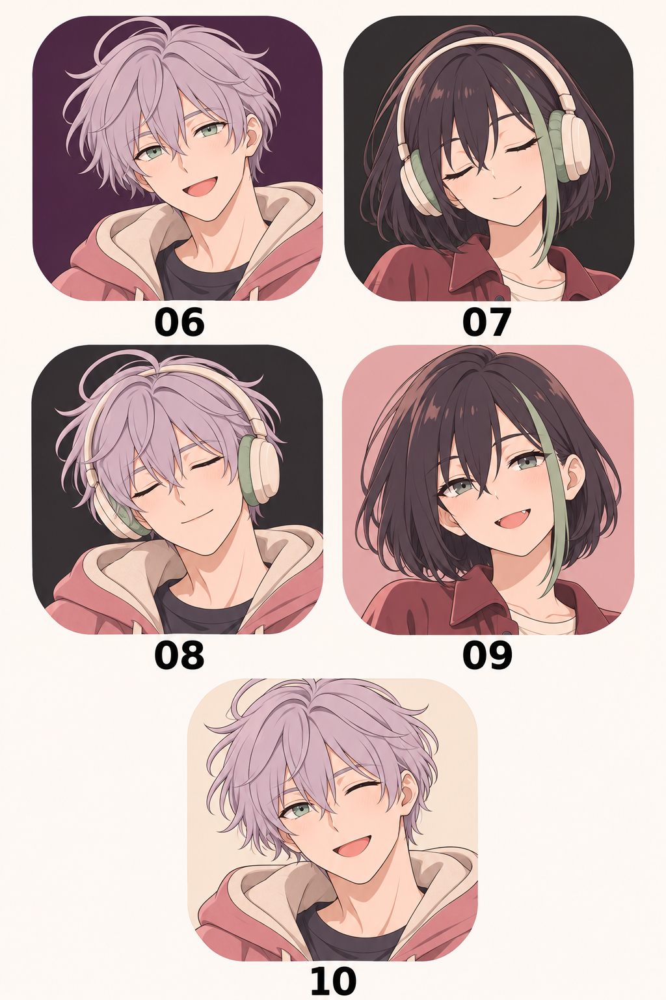
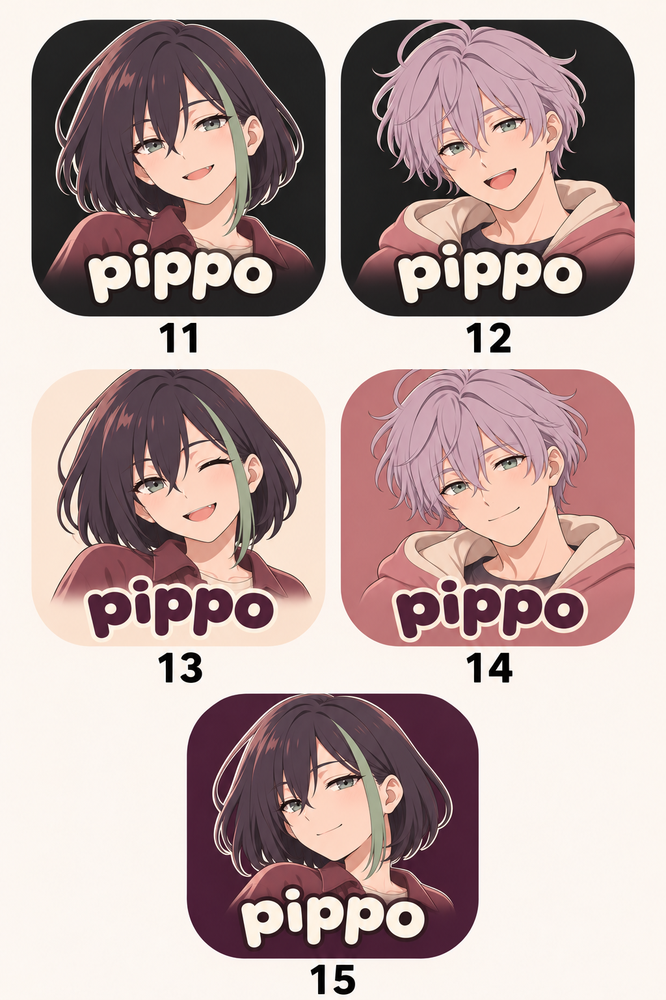
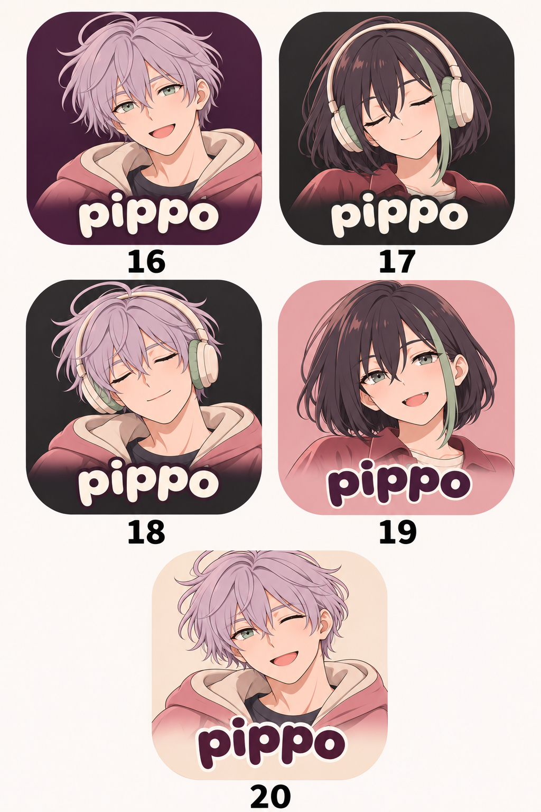

# Pippo anime app-icon previews — 20 numbered options

Based on the owner's selected female character 02 and male character 06. Icon preview stamp numbers below are separate from those original character IDs.

- Icons 01–10: portrait only.
- Icons 11–20: matching portraits with rounded lowercase pippo lettering.
- Matching pairs: 01/11, 02/12, 03/13, 04/14, 05/15, 06/16, 07/17, 08/18, 09/19, 10/20.

These are AI-generated artwork previews. Faces, spacing, lettering, monochrome treatment and adaptive safe areas will need refinement for the selected final assets. No Android icons were replaced, random selection was not implemented, and no builds, tests or GitHub Actions were run.

## Portraits 01–05

## Portraits 06–10

## With pippo lettering 11–15

## With pippo lettering 16–20

