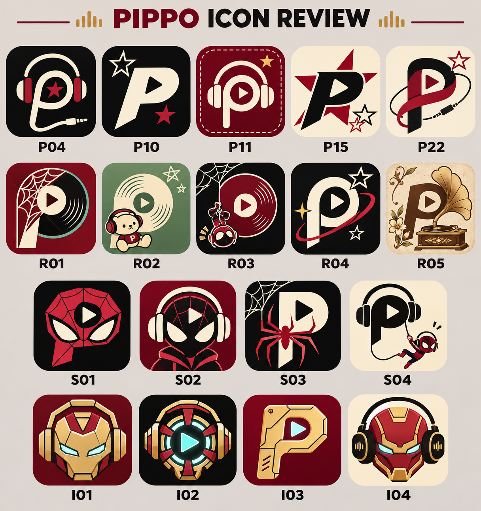

# Pippo · Complete icon approval preview

**Preview only. Awaiting your confirmation before any launcher/app changes.**

[OPEN THE FULL-RESOLUTION 18-ICON OVERVIEW](https://raw.githubusercontent.com/Bhavishyadalal/Pippo/preview-beta-v0.1.2/docs/icon-concepts/approval-board-v6/pippo-icon-review-18.png)

## What the identifiers mean

| Group | IDs | Included designs |
| --- | --- | --- |
| Your five selected directions | **P04, P10, P11, P15, P22** | Cable P, angular star P, stitched cherry headphones, black/red star P, intertwined ribbon P. |
| Your five supplied reference themes, adapted to Pippo | **R01–R05** | Red web/teal record, sage headphone teddy, hanging web character, black/ivory star orbit, parchment floral gramophone. |
| Spider-Man-influenced proposals | **S01–S04** | Web-mask P, headphone web-hero, spider/P, hanging cable acrobat. |
| Iron Man-influenced proposals | **I01–I04** | Armored headphone helmet, play-core reactor, gold armor P, red/gold audio helmet. |

Use these identifiers when approving the set or requesting changes.

The selected designs are **redrawn representations on this combined overview**, not pixel-identical crops. Your previously selected artwork remains unchanged in the [01–12 gallery](../pinterest-inspired-v4/README.md) and [13–22 gallery](../star-cable-v5/README.md). Those earlier sheets remain the references for the selected five; the final individual artwork can be refined after approval.

## Reference search and generation

Pinterest was explicitly searched for Spider-Man/music icon, Iron Man/arc-reactor icon and Spotify-themed icon ideas. An accessible [Spider-Man app-icon Pinterest pin](https://www.pinterest.com/pin/1026750415049325745/) supplied a reference for a cohesive red/blue, web-themed icon collection. Iron Man-specific Pinterest searches did not return usable direct pins; broader image-search examples included [an arc-reactor emblem reference](https://toppng.com/free-image/iron-man-PNG-free-PNG-Images_98985). These were inspiration references, not downloaded icon assets added to the app.

Two attempts to generate the combined board with explicit third-party branding were rejected by the image generator with an unspecified output safety reason. The successful board uses **Pippo music marks for the five reference adaptations**, rather than Spotify's three-arc logo, and generated web/armor-inspired artwork. This substitution is shown here for approval; it is not presented as an exact regeneration of the supplied branded icons.

## Installation remains pending

Only this generated PNG and its documentation are committed. No manifest, launcher aliases, icon-picker entries, runtime artwork, splash animation or application code was edited. No tests, APK builds or GitHub Actions ran. Main and stable are untouched.

After you approve the visual set, the individual icon masters and Android density/adaptive-mask variants can be prepared and integrated. The contact sheet itself is an approval artifact, not a production launcher resource.
