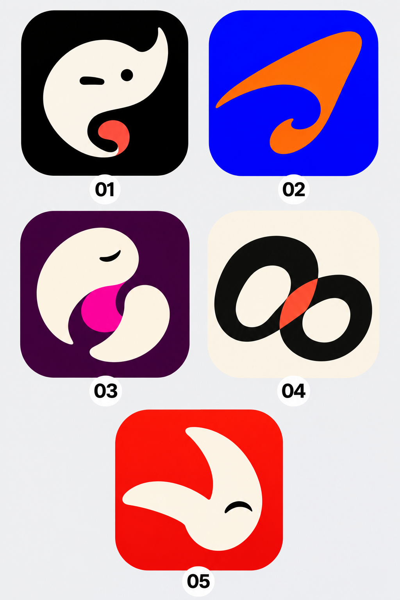
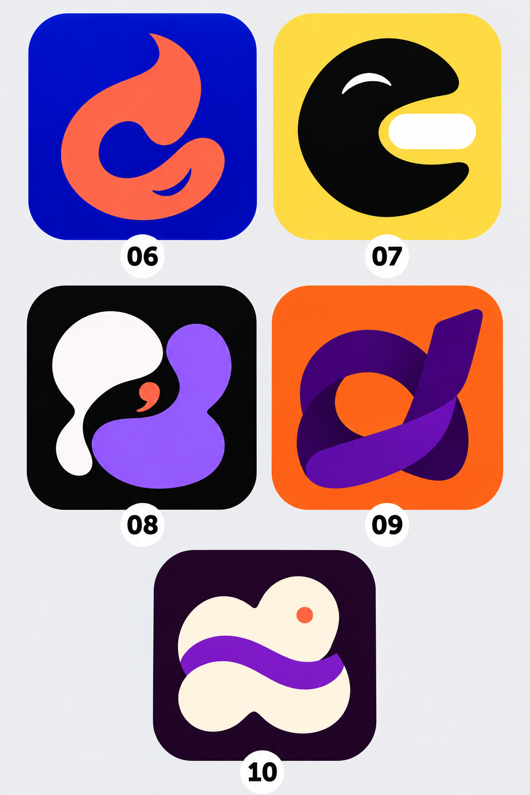

# Pippo expressive main-icon exploration — set 3

Ten AI-generated concept previews exploring more expressive silhouettes, sound-creature motifs, ribbon motion and stronger color contrasts. Numbers 01–10 refer to this set only.

These are artwork directions for selection, not production vector logos. Small-size rendering, geometric consistency and adaptive-icon masking still need work on whichever concept is selected. Android icons and app code are unchanged. No builds, tests or GitHub Actions were run.

## Concepts 01–05

## Concepts 06–10

The shortlist for further refinement is 01, 05 and 08. Choose any stamp, or combine a specific silhouette with a preferred palette from another concept.
