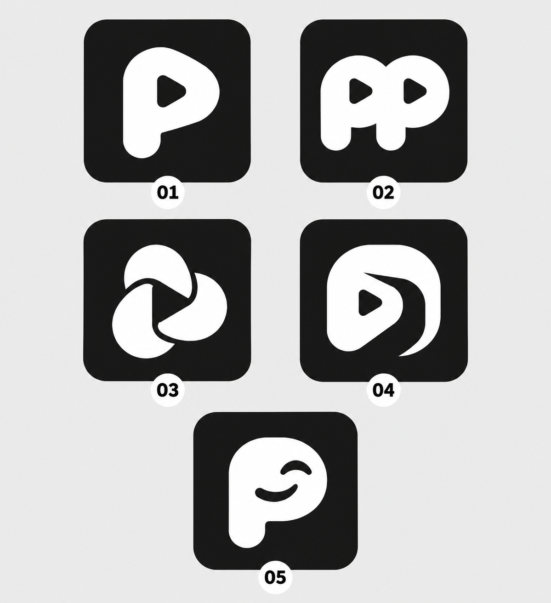
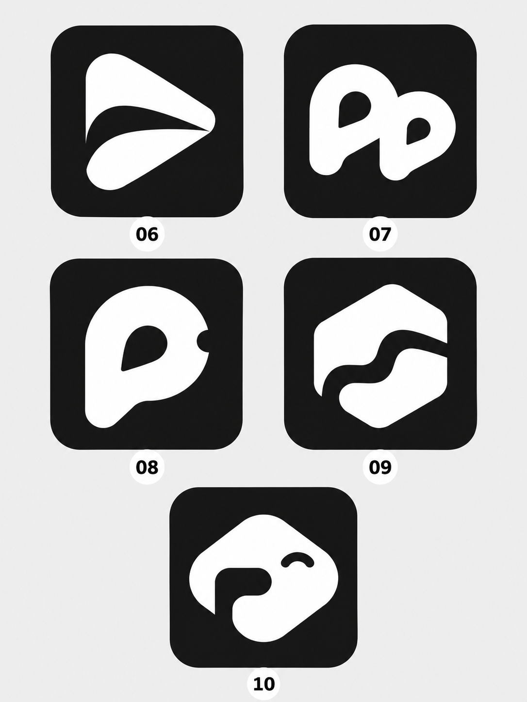

# Pippo main icon — monochrome revision

A second set of ten numbered, AI-generated logo directions after the first colorful concepts were rejected. The current Mochy launcher icon was supplied as a visual reference for compact silhouette, contrast and negative-space treatment; these are proposed Pippo symbols for selection.

All numbers refer to THIS black-and-white set. These are raster concept previews, not finished vector assets, and their small-size readability has not been tested. The selected design needs geometric refinement before adaptive, outline and themed-icon variants are prepared.

## Concepts 01–05

## Concepts 06–10

No launcher resources or application code were changed. No builds, tests or GitHub Actions were run.
