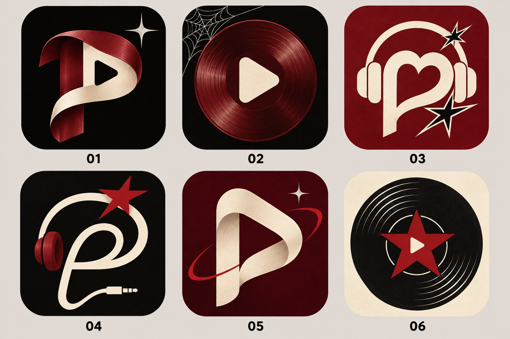
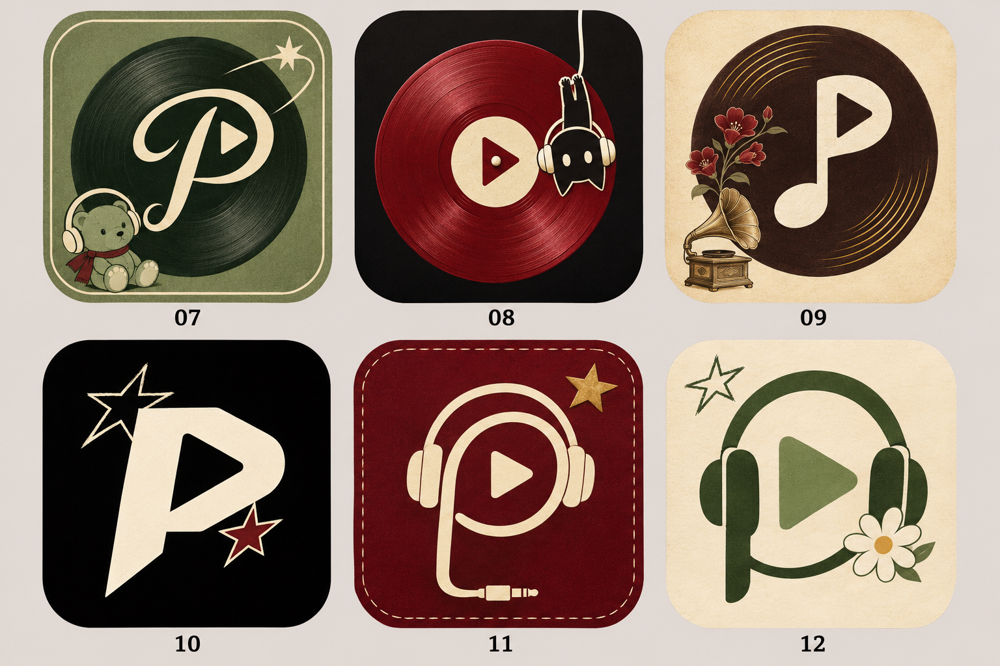

# Pippo · 12 main-icon concepts

New AI-generated artwork inspired by the supplied references' cherry-red/black, sage/cream, star, web and vintage-record aesthetics. The central symbols explore Pippo's own P/play/headphone identity. These are concept previews for selection; the installed launcher icons, startup animation and app code are unchanged.

**Choose by number: 01–12.** The number sits below each icon, outside its artwork. Tap a sheet to open it, then zoom in. Both original PNG sheets are 1536 × 1024.

## 01–06 · Cherry, ink and ivory

[Open full-resolution sheet 01–06](https://raw.githubusercontent.com/Bhavishyadalal/Pippo/preview-beta-v0.1.2/docs/icon-concepts/pinterest-inspired-v4/pippo-01-06.png)

| Number | Concept |
| --- | --- |
| **01** | Cherry Ribbon — folded P/play emblem and silver sparkle. |
| **02** | Web Vinyl — burgundy record, ivory play center and corner web. |
| **03** | Heartbeat — heart/headphone P with sharp layered stars. |
| **04** | Star Cable — flowing headphone-cable monogram and red star. |
| **05** | Orbit Ribbon — sculptural ivory P/play loop with a red orbit. |
| **06** | Star Press — red star/play spindle over black vinyl and cream. |

## 07–12 · Cozy, midnight and vintage

[Open full-resolution sheet 07–12](https://raw.githubusercontent.com/Bhavishyadalal/Pippo/preview-beta-v0.1.2/docs/icon-concepts/pinterest-inspired-v4/pippo-07-12.png)

| Number | Concept |
| --- | --- |
| **07** | Sage Mixtape — forest-green vinyl, script P and headphone teddy. |
| **08** | Midnight Sprite — cherry vinyl with an upside-down headphone sprite. |
| **09** | Pressed Melody — parchment, musical P, gramophone and burgundy flowers. |
| **10** | Ink Star — bold ivory play/P with outlined star accents. |
| **11** | Cherry Mixtape — cable P/headphones with gold star and stitched border. |
| **12** | Daisy Play — sage and cream headphones, play/P mark and daisy. |

These are generated design proposals, not app screenshots, production adaptive-icon assets, or internet images presented as original work. Further refinements and Android icon variants can follow the selected number. No tests, builds, APKs or GitHub Actions were run for this artwork-only update. Main and stable are unchanged.

## Selected direction and next round

The selected favorites are **04, 10 and 11**. [See 10 more designs, numbered 13–22](../star-cable-v5/README.md), exploring their stars, headphone cables and bold P/play marks.
