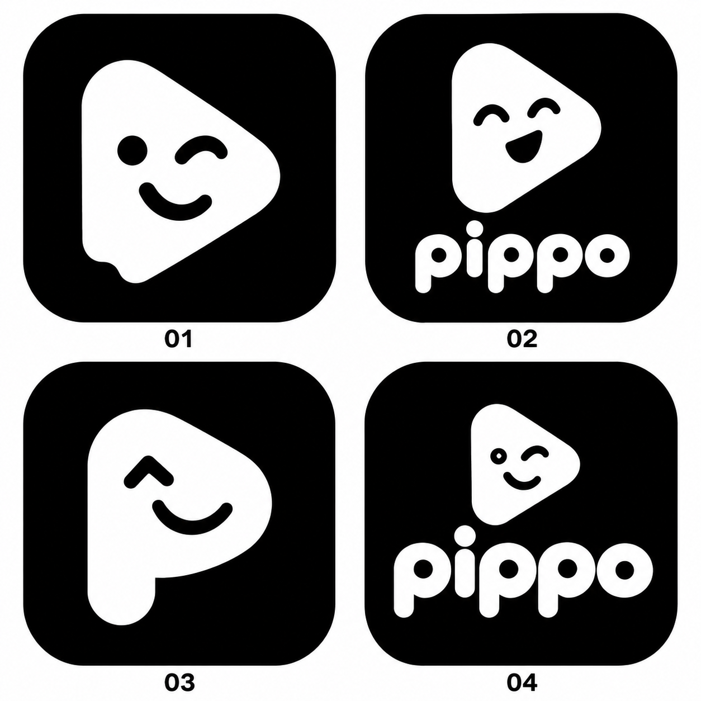

# Pippo icon concepts — direct Mochy reference

Four focused AI-generated monochrome concept previews using the current Mochy launcher icon as the direct visual reference, following the owner's request for a similar rounded play-mark personality and optional app-name lettering.

- 01: Rounded play-face symbol.
- 02: Play-face symbol with pippo wordmark.
- 03: P-shaped play-face symbol.
- 04: Name-led pippo lockup with a smaller play-face symbol.

These are selection previews. The chosen direction needs precise vector refinement and adaptive-icon preparation. No Android icons or code changed; no builds, tests or Actions ran.
