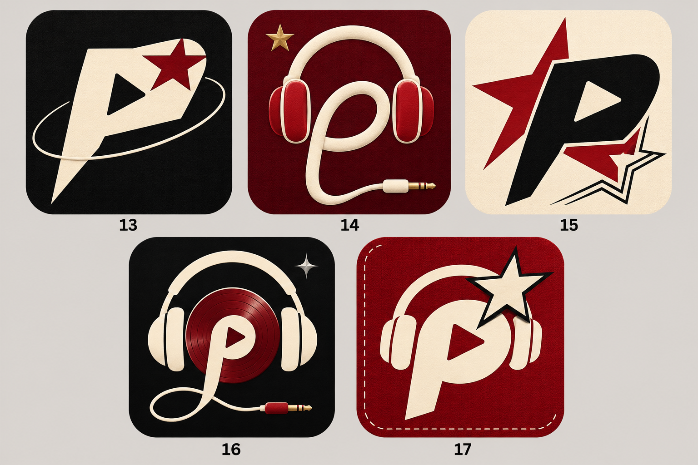
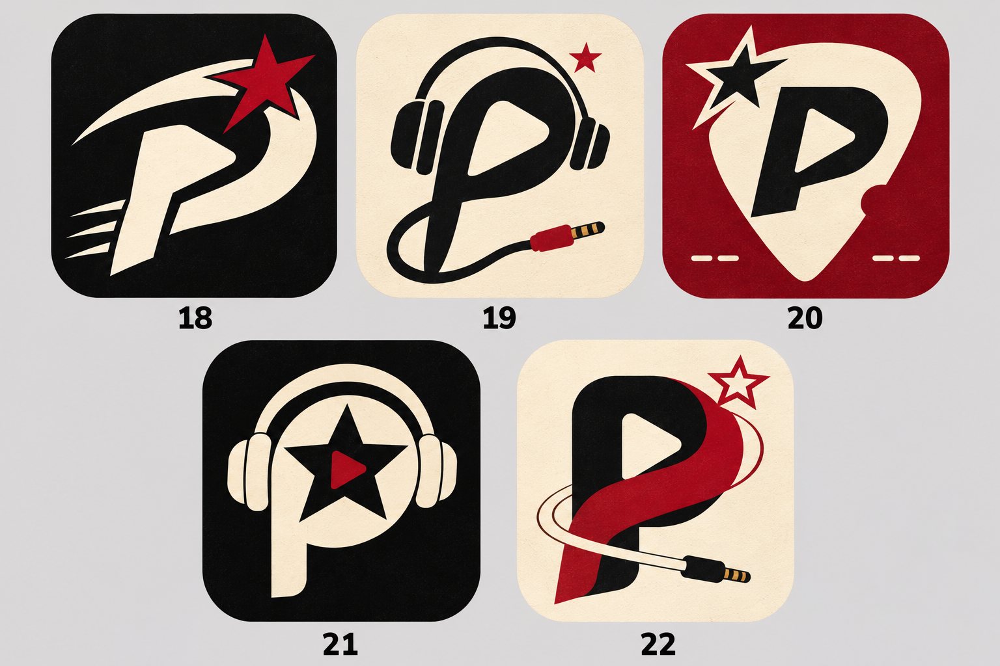

# Pippo · Star & cable · 10 new concepts

**Your selected earlier concepts: 04, 10 and 11.** This round develops their bold P/play silhouettes, headphone cables, stars and black/ivory/cherry-red palette. The new numbers are **13–22**, so earlier selections remain unambiguous.

AI-generated artwork previews for choosing and refining the identity. Existing app icons and app code are unchanged. Each number appears below its icon, outside the artwork. Open a full-resolution sheet and zoom in on your phone.

## 13–17

[Open full-resolution sheet 13–17](https://raw.githubusercontent.com/Bhavishyadalal/Pippo/preview-beta-v0.1.2/docs/icon-concepts/star-cable-v5/pippo-13-17.png)

| Number | Concept |
| --- | --- |
| **13** | Starcut — angular ivory P, cherry star and a fine orbit. |
| **14** | Cherry Cable — flowing headphone p with red earcups and a gold star. |
| **15** | Afterglow — bold black P with layered red stars on ivory. |
| **16** | Velvet Mixtape — cream headphones, cherry vinyl and a loose cable signature. |
| **17** | Scarlet Stitch — compact ivory P/play, oversized star and a stitched edge. |

## 18–22

[Open full-resolution sheet 18–22](https://raw.githubusercontent.com/Bhavishyadalal/Pippo/preview-beta-v0.1.2/docs/icon-concepts/star-cable-v5/pippo-18-22.png)

| Number | Concept |
| --- | --- |
| **18** | Sonic Comet — sweeping ivory P/play with a cherry star and speed cuts. |
| **19** | Cable Signature — black headphone-cable p on ivory with a red jack. |
| **20** | Backstage Pass — pick-shaped ivory badge, black P and layered star. |
| **21** | Starloop — headphone P enclosing a star and red play center. |
| **22** | Cherry Encore — intertwined black/red P ribbons and an orbiting audio cable. |

[Compare with the original 01–12 gallery](../pinterest-inspired-v4/README.md).

These two sheets are 1536 × 1024 PNGs. No launcher replacement, APK generation, tests or GitHub Actions were performed for this artwork-only update. Main and stable remain unchanged.
