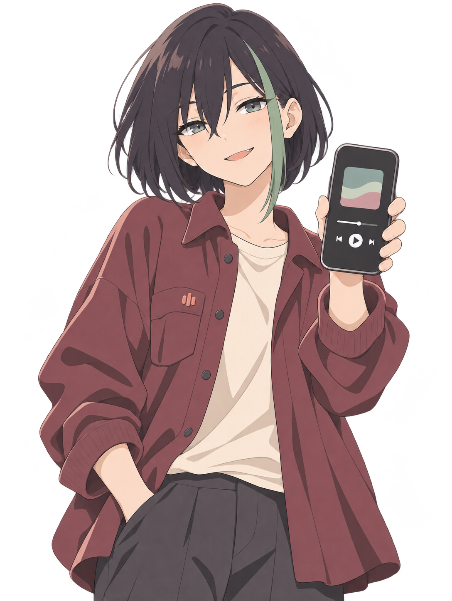
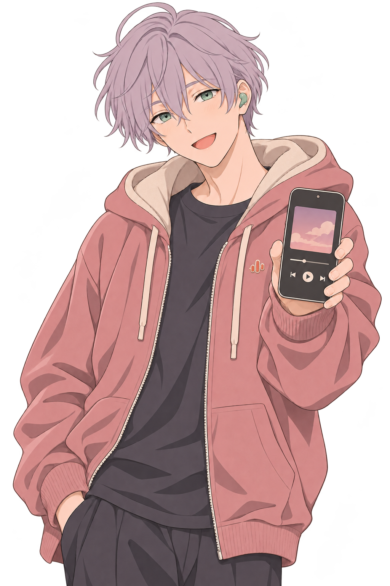
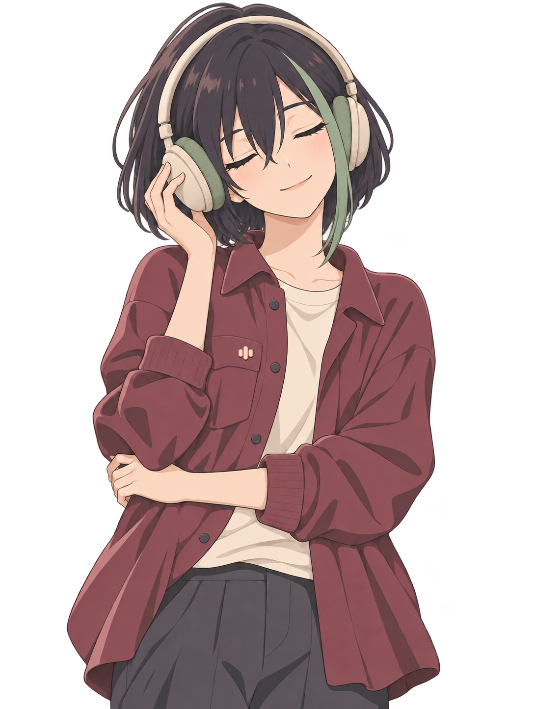
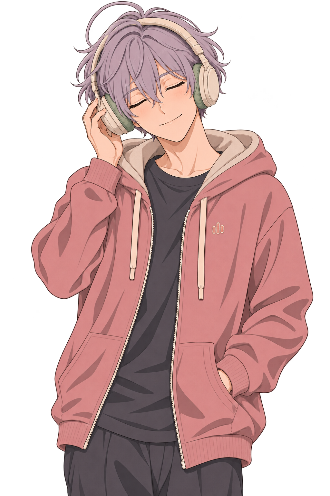
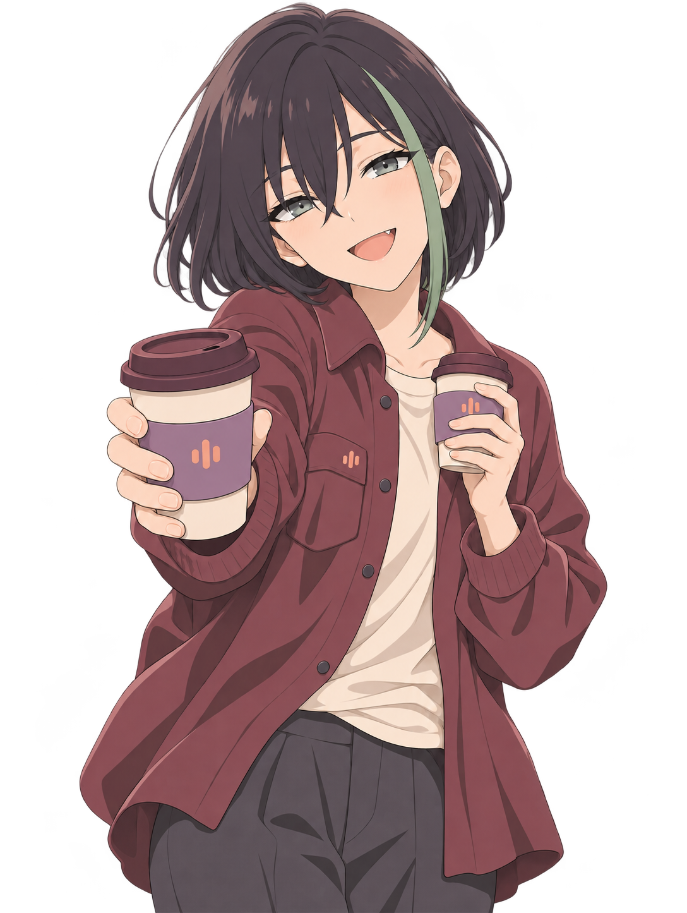
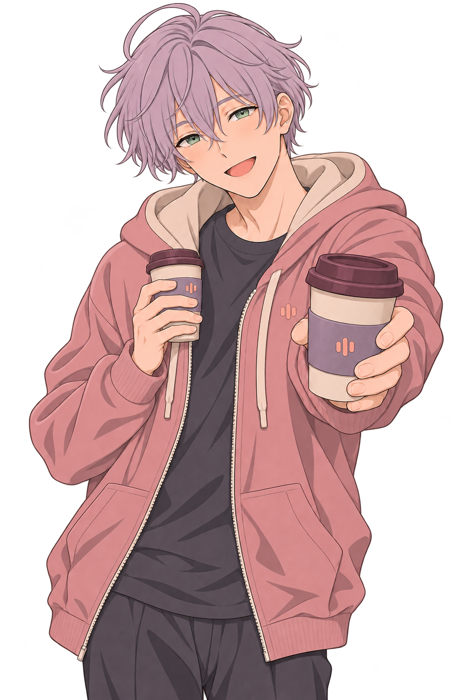

# Refined cozy Pippo mascots — selected characters 02 and 06

Six AI-generated illustrations based on the owner's selected character concepts. Soft mulberry, dusty rose, warm cream and sage accents; shared coral three-bar sound-wave emblems; retained character identities. The earlier crescent-and-dot motif has been removed from all six current previews, and the warm-drink cup sleeves are muted lavender. Transparent PNG originals are preserved here for review and future asset preparation.

These are artwork files only. Android resources, animation layers and random character selection have not been changed. No app builds, tests or GitHub Actions were run.

## Choose by character and pose

| Pose | Female 02 | Male 06 |
| --- | --- | --- |
| A — Welcome / phone | [02-A](02-A-welcome.png) | [06-A](06-A-welcome.png) |
| B — Listening / headphones | [02-B](02-B-listening.png) | [06-B](06-B-listening.png) |
| C — Thank you / warm drinks | [02-C](02-C-thanks.png) | [06-C](06-C-thanks.png) |

## A — Welcome

| 02-A | 06-A |
| --- | --- |
|  |  |

## B — Listening

| 02-B | 06-B |
| --- | --- |
|  |  |

## C — Thank you

| 02-C | 06-C |
| --- | --- |
|  |  |
